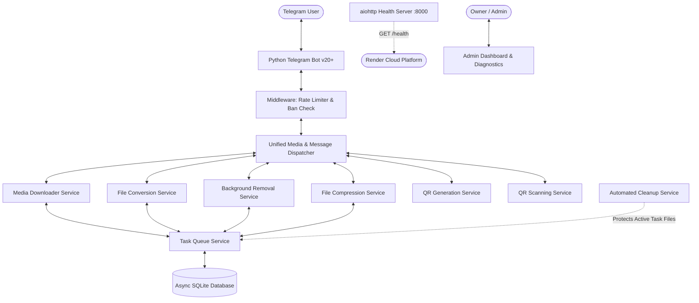

# 🚀 Productivity Hub - Production-Ready Telegram Bot

[](https://render.com)
[](https://www.python.org/)
[](LICENSE)

A high-performance, asynchronous Telegram **Productivity Hub Bot** built with Python 3.11 and `python-telegram-bot` v20+. Designed for enterprise reliability, high concurrency, and low memory usage on cloud environments like Render, providing universal media downloading, multi-format file conversion, AI background removal, file compression, and QR code utilities.

---

## 📑 Table of Contents

- [Project Overview](#-project-overview)
- [Primary Modules](#-primary-modules)
- [Conversion Matrix](#-supported-conversion-matrix)
- [System Architecture](#-system-architecture)
- [Tech Stack](#-tech-stack)
- [Installation & Local Setup](#-installation--local-setup)
- [Environment Variables](#-environment-variables)
- [Render CI/CD Deployment](#-render-cicd-deployment)
- [Running Automated Tests](#-running-automated-tests)
- [Security & Hardening](#-security--hardening)
- [Troubleshooting & Gotchas](#-troubleshooting--gotchas)

---

## 🌟 Project Overview

Productivity Hub consolidates 6 essential digital utility suites into a single, intuitive Telegram bot interface:

1. **🎬 Universal Media Downloader** (`yt-dlp`)
2. **🔄 Universal File Converter** (Dynamic multi-format engine)
3. **🪄 Image Background Remover** (`rembg` / `u2netp`)
4. **📦 Universal File Compressor** (Multi-format optimizer with honest metrics)
5. **🔳 QR Code Generator** (Structured payloads: URLs, Wi-Fi, vCard, Events, UPI)
6. **🔍 QR Code Scanner** (High-precision OpenCV & pyzbar decoding)

The application is backed by a **bounded worker task queue**, **file cleanup protection**, **sliding-window rate limiters**, and an **aiohttp health check server** for seamless Render zero-downtime deployments.

---

## ⚡ Primary Modules

| Module | Features & Capabilities |
| :--- | :--- |
| **🎬 Media Downloader** | Asynchronous `yt-dlp` integration supporting YouTube, Instagram, TikTok, Twitter/X, Snapchat, Facebook, Reddit, Vimeo, and SoundCloud. Pre-extracts metadata before downloading, offers interactive format choices (`360p`, `720p`, `1080p`, `MP3 320k`, `MP3 128k`), streams throttled progress bars, and enforces strict file size caps. |
| **🔄 File Converter** | Dynamic conversion matrix powered by Pillow, FFmpeg, LibreOffice, pypdf, python-docx, openpyxl, and pandas. Smart magic-byte signature inspection with paginated format selection keyboards. |
| **🪄 Background Remover** | AI-driven background removal powered by `rembg` (lazy-loaded lightweight `u2netp` ONNX model). Enforces memory scaling limits (max 2048px) and always delivers output as uncompressed transparent PNG documents to preserve alpha channels. |
| **📦 File Compressor** | Adaptive compression engine for Images (JPEG/PNG/WEBP/HEIC), PDFs (Ghostscript/pypdf), Audio/Video (FFmpeg adaptive bitrates), and Archives. Offers Low, Medium, and High compression profiles with honest before/after comparison metrics. |
| **🔳 QR Generator** | Generates high-contrast QR codes across 7 structured categories: Website URLs, Plain Text, Wi-Fi credentials (`WIFI:`), Contact Cards (vCard 3.0), Calendar Events (iCalendar `VEVENT`), SMS (`SMSTO:`), and UPI Payment links (`upi://pay`). |
| **🔍 QR Scanner** | Robust image decoder utilizing `OpenCV` (`cv2.QRCodeDetector`) with `pyzbar` fallback. Automatically extracts structured attributes, presents copyable raw text, and generates explicit, safe link buttons for verified HTTP/HTTPS targets. |
| **👑 Admin Dashboard** | Secure `/admin` control panel accessible exclusively to authorized numeric `OWNER_ID`: Real-time system diagnostics (CPU, RAM, Storage, Uptime, Queue status), runtime dependencies health check (`/adm:deps`), user ban/unban management, audit logs, and maintenance mode toggle. |

---

## 🔄 Supported Conversion Matrix

| Category | Source Formats | Target Formats | Engine Backend |
| :--- | :--- | :--- | :--- |
| **Images** | `PNG`, `JPG`, `JPEG`, `WEBP`, `BMP`, `TIFF`, `ICO`, `GIF` | `PNG`, `JPG`, `WEBP`, `PDF`, `ICO`, `BMP` | Pillow / ImageOps |
| **Documents** | `DOCX`, `DOC`, `ODT`, `RTF`, `TXT`, `HTML`, `PDF` | `PDF`, `DOCX`, `TXT`, `HTML` | LibreOffice / pypdf / python-docx |
| **Spreadsheets** | `XLSX`, `XLS`, `CSV`, `ODS` | `CSV`, `XLSX`, `PDF`, `HTML` | openpyxl / pandas / LibreOffice |
| **Audio** | `MP3`, `WAV`, `OGG`, `M4A`, `AAC`, `FLAC`, `OPUS` | `MP3`, `AAC`, `M4A`, `OGG`, `WAV`, `FLAC` | FFmpeg |
| **Video** | `MP4`, `MKV`, `AVI`, `MOV`, `WEBM`, `FLV` | `MP4`, `WEBM`, `GIF`, `MP3` | FFmpeg |
| **Archives** | `ZIP`, `TAR`, `GZ` | `ZIP`, `TAR`, `GZ` | Python zipfile / tarfile |

---

## 🏗️ System Architecture



- **Non-Blocking Concurrency**: Heavy CPU and disk tasks run asynchronously via dedicated worker thread pools (`asyncio.to_thread`).
- **Bounded Task Queue**: Prevents RAM spikes on low-tier hosting (Render 512 MB). Configured with `MAX_CONCURRENT_TASKS=2`, `MAX_USER_ACTIVE_TASKS=1`, and `MAX_QUEUE_SIZE=50`.
- **Active Task File Protection**: The `CleanupService` queries `TaskQueueService.get_active_file_paths()` before every sweep to ensure in-flight files are never purged.
- **Circuit Breakers**: External dependencies (e.g., LibreOffice, FFmpeg, rembg) are probed once on startup and cached, preventing repeated subprocess crashes if an optional binary is missing.

---

## 🛠️ Tech Stack

- **Runtime**: Python 3.11+
- **Telegram Bot Engine**: `python-telegram-bot` v20.7 (full async coroutines)
- **Database**: SQLite3 via `aiosqlite` with WAL mode and automated DDL migrations
- **Web & Health**: `aiohttp` (integrated lightweight HTTP health server on port 8000)
- **Media & Processing**: `yt-dlp`, `Pillow`, `pypdf`, `reportlab`, `python-docx`, `openpyxl`, `pandas`, `rembg`, `qrcode`, `opencv-python-headless`, `pyzbar`
- **System Monitoring**: `psutil`
- **Testing**: Python `unittest` suite (36 comprehensive test cases)

---

## 🚀 Installation & Local Setup

### Prerequisites

- Python 3.11 or higher
- Git
- FFmpeg (required for video/audio conversions and media merging)

### 1. Clone Repository & Setup Virtual Environment

```bash
git clone https://github.com/Piyush0450/downloader-bot.git
cd downloader-bot

# Create virtual environment
python -m venv venv

# Activate virtual environment
# Windows:
.\venv\Scripts\activate
# Linux/macOS:
source venv/bin/activate
```

### 2. Install Dependencies

```bash
pip install -r requirements.txt
```

### 3. Environment Configuration

Copy `.env.example` to `.env`:

```bash
cp .env.example .env
```

Configure the essential keys:

```env
BOT_TOKEN=123456789:ABCdefGhIJKlmNoPQRsTUVwxyZ
OWNER_ID=123456789
BOT_MODE=polling
PORT=8000
DATABASE_PATH=database/app.sqlite3
```

### 4. Run the Bot

```bash
python bot.py
```

The bot will execute its 13-step startup sequence, verify dependencies, run database migrations, start the background queue, and launch the health check server at `http://localhost:8000/health`.

---

## ⚙️ Environment Variables

| Variable | Required | Default | Description |
| :--- | :---: | :--- | :--- |
| `BOT_TOKEN` | **Yes** | - | Telegram Bot API token obtained from [@BotFather](https://t.me/BotFather) |
| `OWNER_ID` | **Yes** | - | Numeric Telegram User ID of the primary administrator / bot owner |
| `SECRET_KEY` | No | Auto-generated | Cryptographic key for session tokens and security hashing |
| `BOT_MODE` | No | `polling` | Operational mode: `polling` (recommended) or `webhook` |
| `PORT` | No | `8000` | Port for the integrated HTTP health check server |
| `DATABASE_PATH` | No | `database/app.sqlite3` | SQLite database file path (persisted on disk) |
| `LOG_LEVEL` | No | `INFO` | Logging verbosity (`DEBUG`, `INFO`, `WARNING`, `ERROR`) |
| `MAX_CONCURRENT_TASKS`| No | `2` | Maximum concurrent background tasks across all users |
| `MAX_USER_ACTIVE_TASKS`| No | `1` | Maximum concurrently running tasks per single user |
| `MAX_USER_QUEUE_TASKS` | No | `3` | Maximum queued tasks allowed per single user |
| `MAX_QUEUE_SIZE` | No | `50` | Global queue capacity limit before rejection |
| `TEMP_RETENTION_MINUTES`| No | `60` | Age cutoff for temporary file cleanup sweeps |
| `MAX_FILE_SIZE` | No | `50` | Maximum upload/download file limit in MB |
| `MAINTENANCE_MODE` | No | `false` | System maintenance mode toggle |

---

## 🌐 Render CI/CD Deployment

This repository is pre-configured for automatic zero-downtime deployment on **Render** using `render.yaml`.

### Deployment Blueprint

1. Push your changes to the primary deployment branch (`main`):
   ```bash
   git push origin main
   ```
2. In the [Render Dashboard](https://dashboard.render.com), connect your GitHub repository (`Piyush0450/downloader-bot`).
3. Render automatically provisions the web service from `render.yaml`:
   - **Environment**: Python (or Docker via `Dockerfile`)
   - **Build Command**: `pip install -r requirements.txt`
   - **Start Command**: `python productivity_hub/bot.py`
   - **Health Check Path**: `/health`
   - **Persistent Disk**: Mounted at `/app/database` (size: 1 GB) to keep user accounts and audit history across redeploys.
4. Set `BOT_TOKEN` and `OWNER_ID` in the Render Environment Variables dashboard.

---

## 🧪 Running Automated Tests

Run the complete 36-test suite using Python's native `unittest` runner:

```bash
python -m unittest discover tests
```

Individual test modules can be targeted directly:

```bash
python -m unittest tests.test_queue_service
python -m unittest tests.test_admin_service
python -m unittest tests.test_compression_service
python -m unittest tests.test_conversion_registry
python -m unittest tests.test_qr_services
python -m unittest tests.test_validators
```

---

## 🔒 Security & Hardening

- **Strict Owner Authentication**: The `/admin` dashboard and management endpoints check against numeric `OWNER_ID` or database records.
- **Menu Ownership Tokens**: All inline keyboard callback queries validate the user ID token embedded in callback data, preventing cross-user button tampering.
- **Zip Slip & Path Traversal Prevention**: Strict canonicalization checks ensure extracted archive contents never escape the destination folder.
- **Decompression Bomb Protection**: Archive extractions enforce a 100 MB total uncompressed limit and a maximum count of 500 files.
- **Secret Redaction**: Telegram bot tokens and API secrets are automatically masked in all console outputs and rotating log files.
- **Safe URL Validation**: QR code scanning checks for well-formed HTTP/HTTPS protocols and non-whitelisted IP addresses before generating clickable link buttons.

---

## ❓ Troubleshooting & Gotchas

1. **`libzbar` Not Found on Windows**:
   - `pyzbar` requires native C libraries on Windows. The bot detects this and automatically falls back to `OpenCV` (`cv2.QRCodeDetector`) with 100% accuracy.
2. **Transparent PNG Compression on Telegram**:
   - Sending background-removed photos via `send_photo` causes Telegram to convert them to non-alpha JPEGs. The bot delivers all transparent images via `send_document` to preserve transparency.
3. **Excel File Locks on Windows**:
   - When converting Excel files, all workbooks are explicitly closed (`wb.close()`) before removal to avoid Windows file sharing violations (WinError 32).
4. **Media Downloader Updates**:
   - Social media platform algorithms change frequently. Run `pip install -U yt-dlp` to update extractor logic if a specific platform fails.

---

## 📄 License

Distributed under the MIT License. See [LICENSE](LICENSE) for details.
